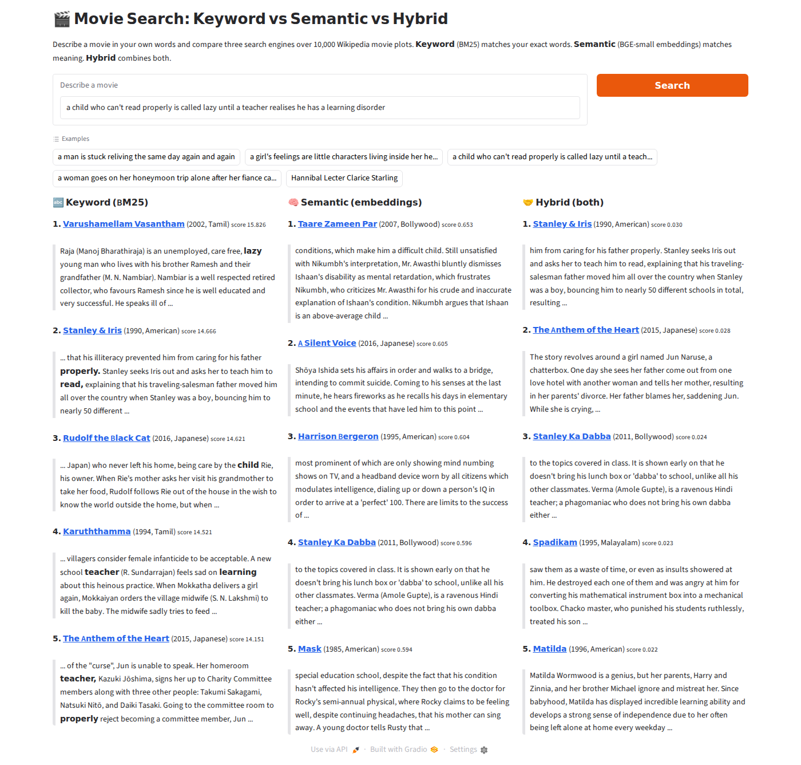

# 🎬 Semantic Movie Search: finding films by meaning, not keywords

Describe a movie in your own words ("*a child who can't read properly is called lazy until a teacher realises he has a learning disorder*") and this app finds it among **10,000 Wikipedia movie plots**. It shows three search engines side by side, so you can see exactly **where keyword search fails and semantic search succeeds**, and where the reverse happens.

**🔗 Live demo:** *(Hugging Face Spaces link goes here after deployment)*



*In the screenshot, keyword search latches onto the words "lazy", "properly" and "teacher" and returns unrelated films. Semantic search puts* Taare Zameen Par *at #1, even though its plot uses different words ("dyslexia", "difficult child").*

---

## The problem

Classic search engines match **words**. If the plot says "*dyslexia*" and you type "*can't read properly*", a keyword engine finds nothing. That's a problem, because people describe things in their own words.

**Semantic search** converts text into **embeddings**: lists of 384 numbers that capture meaning. Texts that mean similar things get similar numbers, even when they share no words. Search becomes "find the plots whose numbers are closest to the query's numbers."

## Results

I wrote 38 test queries, each with one known correct movie, and measured where each engine ranked that movie ([full table](results/evaluation.md)).

| Query type | Queries | Keyword Hit@5 | Semantic Hit@5 | Hybrid Hit@5 | Keyword MRR | Semantic MRR | Hybrid MRR |
|---|---|---|---|---|---|---|---|
| **Describe the idea** (natural language) | 32 | 47% | **59%** | **59%** | 0.45 | 0.45 | **0.51** |
| **Exact names** ("Hannibal Lecter Clarice Starling") | 6 | **100%** | **100%** | **100%** | **0.83** | 0.69 | 0.81 |
| All | 38 | 55% | **66%** | **66%** | 0.51 | 0.49 | **0.55** |

- **Hit@5** = how often the correct movie appeared in the top 5 results.
- **MRR** (Mean Reciprocal Rank) = the average of 1/rank. It's 1.0 if the answer is always first, 0.5 if always second, and 0 if never found.

### Where semantic search wins

| Query | Keyword rank | Semantic rank |
|---|---|---|
| a child who can't read properly is called lazy until a teacher realises he has a learning disorder (*Taare Zameen Par*) | not in top 100 | **1** |
| a girl's feelings are little characters living inside her head (*Inside Out*) | not in top 100 | **3** |
| a man with short-term memory loss tracks down the person who murdered his wife (*Memento*) | not in top 100 | **14** |
| a gangster pretends to be a doctor in training so his parents think he is respectable (*Munna Bhai M.B.B.S.*) | 39 | **3** |
| a divorced dad disguises himself as an elderly nanny so he can see his kids (*Mrs. Doubtfire*) | 46 | **5** |

### Where keyword search wins

| Query | Keyword rank | Semantic rank |
|---|---|---|
| a board game brings wild jungle animals into a small town (*Jumanji*) | **1** | 98 |
| a child who can see ghosts is treated by a psychologist (*The Sixth Sense*) | **1** | 30 |
| a woman goes on her honeymoon trip alone after her fiance calls off the wedding (*Queen*) | **26** | not in top 100 |

When the query contains a **distinctive word that also appears in the plot** ("board game", "psychologist", "honeymoon"), keyword search is hard to beat. **Hybrid search** combines both rankings and has the best overall MRR, because it rarely fails badly.

## How it works

```
OFFLINE (run once)                                ONLINE (every search)
──────────────────                                ─────────────────────
34,886 Wikipedia plots                            "a man relives the same day"
   │ clean, dedupe, keep 10,000                        │
   ▼                                                   ├──► BM25 keyword scores ──┐
10,000 plots                                           │                          ├─► Reciprocal Rank
   │ split into 150-word chunks                        └──► embed query ──►       │   Fusion (hybrid)
   ▼                                                        cosine similarity ────┘
58,964 chunks ──► BGE-small ──► 58,964 × 384 matrix        vs. all 58,964 chunks
                                 (saved to disk)            (one matrix multiply)
```

1. **Data** (`prepare_data.py`): downloads the [Wikipedia Movie Plots](https://www.kaggle.com/datasets/jrobischon/wikipedia-movie-plots) dataset, strips citation marks like `[3]`, fixes hidden spaces in titles, removes duplicate films, and keeps the 10,000 films from 1980 onward with the longest plot sections. Longer Wikipedia plots are a rough proxy for well-known films. The subset includes American, British, Bollywood, Tamil, Telugu, Malayalam, Japanese and other films.
2. **Keyword search** (`keyword_search.py`): BM25 via `rank-bm25`. It scores movies by how often they contain the query words, giving extra weight to rare words.
3. **Embeddings** (`build_embeddings.py`): each plot is split into overlapping 150-word **chunks**, and each chunk is embedded with [`BAAI/bge-small-en-v1.5`](https://huggingface.co/BAAI/bge-small-en-v1.5) through `sentence-transformers`. The embeddings are stored as float16 (45 MB).
4. **Semantic search** (`semantic_search.py`): embeds the query, computes cosine similarity against all chunks with one NumPy matrix multiplication, and scores each movie by its **best-matching chunk**. The app shows that chunk, so you can see *why* a movie matched.
5. **Hybrid search** (`hybrid_search.py`): merges the two rankings with **Reciprocal Rank Fusion**: `score = 1/(60 + keyword_rank) + 1/(60 + semantic_rank)`.
6. **Evaluation** (`evaluate.py`) and the **Gradio app** (`app.py`).

## Decisions I made (and why)

- **Chunking instead of one embedding per plot.** Plots average around 700 words. A single embedding for the whole plot blurs many scenes together, and many models only read the first 256–512 tokens anyway. Chunking lets a query match the one passage that describes it.
- **Switching models based on measurements.** I started with `all-MiniLM-L6-v2`, the model most tutorials use. On the "describe the idea" queries it scored **Hit@5 44% / MRR 0.39**, which was *worse* than keyword search. `bge-small-en-v1.5` is about the same size but was trained specifically for search (short question → long passage). It raised this to **59% / 0.45**. BGE also expects a short instruction prefix on queries (not on documents), which I add in `semantic_search.py`.
- **Ranks, not scores, for the hybrid.** BM25 scores look like 15.8 and cosine scores like 0.65, so they can't be added directly. Reciprocal Rank Fusion uses only positions in each list, so no tuning is needed.
- **Precompute embeddings.** Embedding 59k chunks takes about an hour on a laptop CPU, but embedding one query takes milliseconds. The app loads the saved matrix at startup.
- **NumPy instead of a vector database.** 59k × 384 fits in about 90 MB of RAM, and one matrix multiply takes a few milliseconds. A vector database (FAISS, Qdrant) only becomes necessary at millions of documents.

## Limitations and next steps

- **Plots narrate, queries summarise.** Wikipedia plots describe events scene by scene ("Phil wakes up at 6:00 AM…"), while users describe the premise ("a man relives the same day"). Some films (*Inception*, *Home Alone*, *Drishyam*) are missed by every engine. A **cross-encoder re-ranker**, or embedding a one-line summary of each film, would likely help.
- **Small, self-written test set.** 38 queries is enough to show patterns but not to claim precise numbers. A larger test set written by other people would be more trustworthy.
- **Hybrid isn't always better.** For *Taare Zameen Par*, semantic ranked it #1 but hybrid dropped it to #13, because keyword search disagreed. Weighting the two engines (or learning the weights) is a natural next step.
- **No stemming in BM25.** "reliving" and "relives" count as different words.

## Run it yourself

Requires Python 3.10–3.12. No GPU needed. The data and precomputed embeddings are included, so you can start the app straight away.

```bash
# Windows (PowerShell), from the project folder:
powershell -ExecutionPolicy Bypass -File setup_windows.ps1
& "$env:USERPROFILE\venvs\movie-search\Scripts\Activate.ps1"

# Mac / Linux:
python3 -m venv venv && source venv/bin/activate && pip install -r requirements.txt

python app.py             # open http://127.0.0.1:7860
python evaluate.py        # re-run the evaluation
```

To rebuild everything from scratch, run `python prepare_data.py`, then `python build_embeddings.py` (about 30–60 minutes on a CPU).

## Project structure

```
├── app.py                 # Gradio web app (3 engines side by side)
├── config.py              # all settings in one place (paths, model, chunk size)
├── prepare_data.py        # download + clean + select 10,000 movies
├── keyword_search.py      # BM25 keyword search
├── semantic_search.py     # chunking + embedding search with NumPy
├── hybrid_search.py       # Reciprocal Rank Fusion
├── build_embeddings.py    # embed all chunks once, save to data/
├── evaluate.py            # Hit@5 and MRR on eval_queries.csv
├── learn_embeddings.py    # tiny playground to see embeddings in action
├── eval_queries.csv       # 38 test queries with known answers
├── results/evaluation.md  # latest evaluation output
├── data/                  # movies.csv.gz + embeddings.npz
└── setup_windows.ps1, check_setup.py, requirements.txt
```

## Tech stack

Python · sentence-transformers · NumPy · pandas · rank-bm25 · Gradio · Hugging Face Spaces

## Credits

- Data: [Wikipedia Movie Plots](https://www.kaggle.com/datasets/jrobischon/wikipedia-movie-plots) by JustinR, collected from Wikipedia (CC BY-SA 4.0).
- Embedding model: [BAAI/bge-small-en-v1.5](https://huggingface.co/BAAI/bge-small-en-v1.5) (MIT).
- Code: MIT License.
